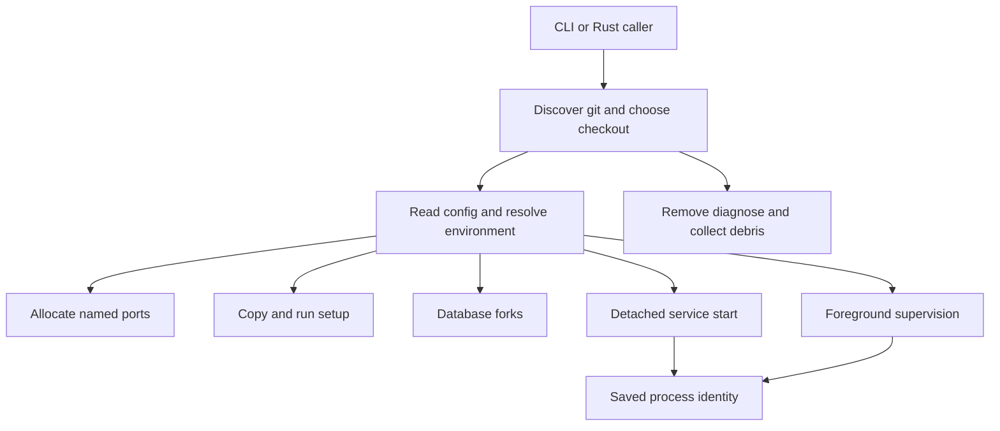

# Give each branch its own environment

canopyd is a Unix Rust library and CLI for git worktrees, ports, setup, services and database forks. Git worktrees are separate checkouts sharing one repository. canopy.yaml describes the environment each checkout should run. Git remains the checkout inventory; files retain the process, port and resource facts git cannot know.

This is the Rust executable used by the separate Canopy application. It is not Canopy's Node daemon, desktop UI or agent service. Most commands run and exit. `up` leaves service processes running; `run` stays in the foreground to supervise and restart them. There is no implicit permanent management daemon after every command.

Start with the task:

- [Create or remove a checkout](worktrees.md), then [choose configuration](configuration.md).
- [Assign ports](ports.md), [copy files and run setup](setup.md), or [fork a database](databases.md).
- [Start detached services](services.md), [supervise them in the foreground](supervision.md), and [interpret process identity](identity.md).
- [Use Docker/Compose](containers.md), [read logs](logs.md), or [diagnose and install hooks](maintenance.md).
- [Integrate the CLI/library](interface.md), [find feature ownership](inventory.md), and [check evidence and known issues](verification.md).

A successful command can contain failed service statuses or cleanup warnings. A Killed outcome is not independent proof every descendant disappeared. Read each result and its owner before retrying an operation with effects.
