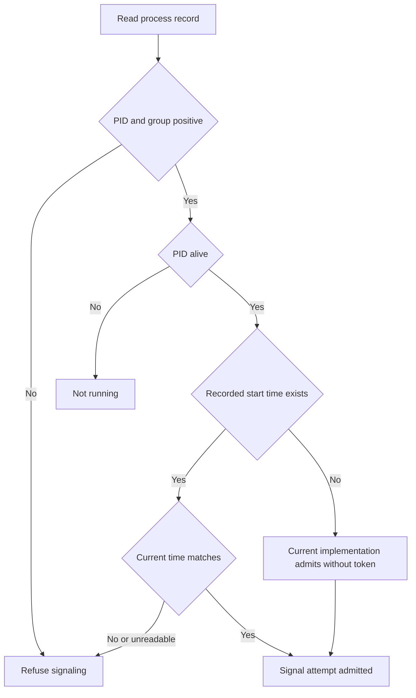

# Decide whether a saved PID still belongs to the service

A process record stores PID, process group, optional OS start time, random launch ID and launch details. A PID is a reusable number, so a record is not by itself evidence the original process is alive. With a recorded start time, the adapter compares it to a fresh observation; mismatch or unreadable current time is stale and signaling is refused. Nonpositive PID/group values are refused too.

## Missing identity is a weaker path

The source treats a positive/live PID with no recorded start_time as Ours. It does not fail closed on that missing field, and the launch ID is not compared in this decision. Do not claim every admitted signal has a verified start-time identity. The identity check and OS signal are separate operations; PID reuse between them is also outside a mathematical check-at-admission guarantee.

`stop` sends the configured signal to the group, with a PID fallback, and waits. It can escalate to SIGKILL and wait another two seconds. The Killed outcome is returned after that attempt even if the final wait did not observe exit; signal return values are not a universal cleanup receipt. Inspect actual process/resource state when cleanup matters.

Known stale/corrupt record paths in service stop retain evidence and report failed instead of deleting it. Other stop outcomes can remove the record. Process-group control is not a sandbox or proof every escaped descendant stopped. Logs and record durability are separate from command success.

## Model boundary

ProcessAdmission includes recorded identity absent (0) or one of two tokens, two independently observed tokens and zero/positive target. It checks positive admitted targets and matching identities only when a recorded token exists. The absent-token branch can pass admission, matching source; it is not disguised as verified identity. Controls remove equality or positivity gates. PID/group positivity is collapsed into one value; OS reads, check-to-signal races, signals, actual exit and descendant cleanup are outside the model. Terminal deadlocks are disabled for finite completed states; these are safety properties with no liveness claim. [Evidence](verification.md) retains review and execution results.
