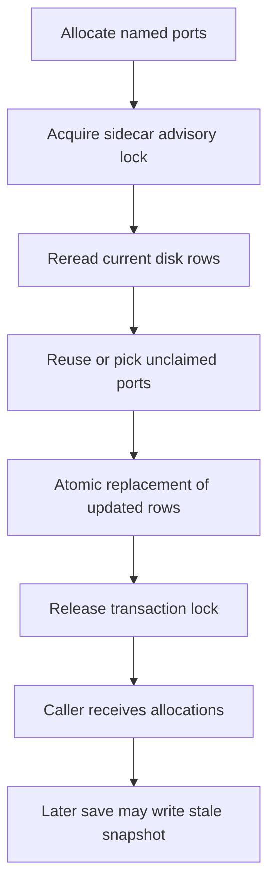

# Keep a named URL stable across restarts

A branch's existing named allocation is reused without probing. New names prefer their configured port when usable, otherwise walk a deterministic hash-seeded range past recorded and bound ports. Host probes check IPv4 and IPv6 where supported. A successful probe is not a permanent socket reservation; another unrelated process can bind afterward.

The default registry lives in the common git directory. CANOPYD_PORTS_FILE selects a shared registry, with repository ownership separating rows; CANOPYD_PORT_RANGE changes defaults. Explicit reservations are not bind-probed because a caller may deliberately reserve a port its service already holds.

## The lock does not cover a later save

Registry::allocate locks, rereads, selects and writes within one transaction. Registry::save separately locks and writes its existing in-memory rows without rereading. Canopy::ports_for calls allocate and then save. A second writer can allocate between those calls, and the first caller's later save can overwrite that newer allocation. The same stale-snapshot concern applies to standalone in-memory reserve/release followed by save.

Do not infer end-to-end concurrent allocation safety from the inner transaction or its model. Serialize higher-level registry writers when using this version, and inspect the retained source probe/evidence for the known lost-update case. Corrupt registries are errors, not silently reset empty tables. A lock timeout is a refusal, not permission to overwrite the registry manually.

A sidecar lock matters because atomic rename replaces the data inode. Atomic replacement prevents partial JSON visibility; it is not a proof of power-loss durability or an external socket lease.

## Model boundary

PortTransaction represents two owners and two ports inside atomic allocate transactions. It checks distinct nonzero ports and retention of earlier committed rows. One control admits an occupied port; another adds the actual problematic later stale snapshot save. The baseline deliberately excludes that later operation and therefore does not qualify Canopy::ports_for or arbitrary Registry::save callers. Lock/file implementation, multi-port batches, legacy empty owner rules, bind races and power loss remain outside this model. Terminal deadlocks are disabled for finite completed states; these are safety properties with no liveness claim. [Evidence](verification.md) retains review and execution results.
