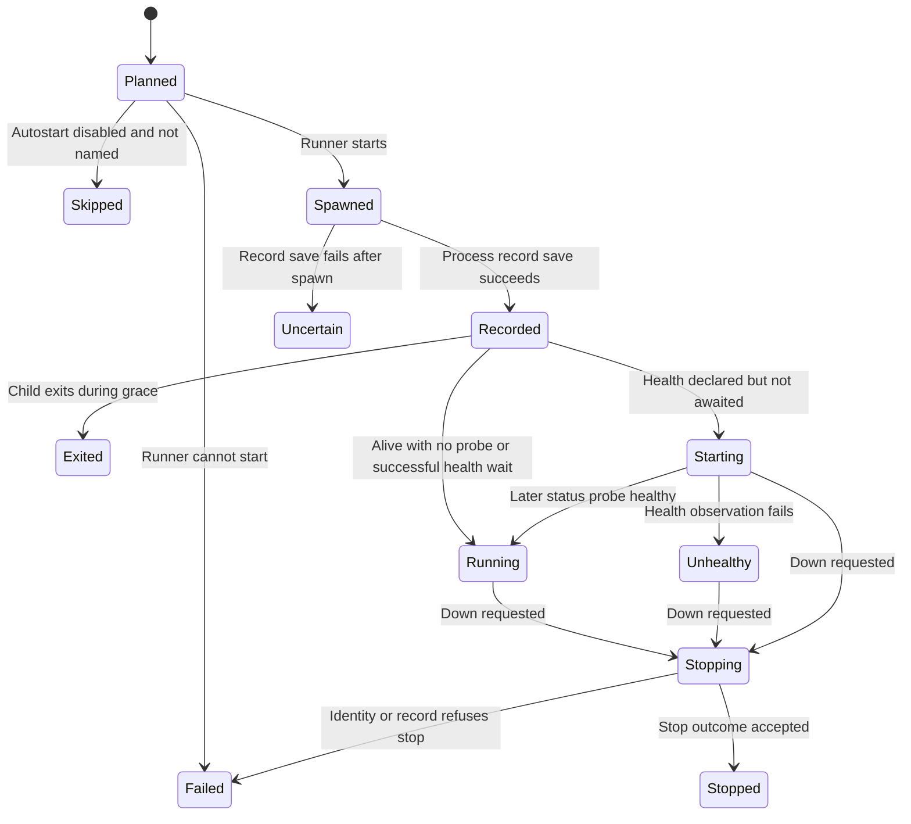

# Leave a development server running after the command exits

`up` plans dependency order and starts selected services. A service with autostart false is skipped unless explicitly named. The child writes stdout/stderr to an append-mode log file rather than a pipe that needs this CLI to remain alive. Existing live records are reused. `up` then exits; restart policy and continuous health polling belong to [foreground run](supervision.md).

## Read the result for every service

Docker/start failures can be represented as a Failed service inside an otherwise returned result. A spawn is followed by record publication before the grace observation. A record-write error can therefore happen after a child exists. With --wait, a never-healthy error can leave the launched service running. Earlier services are not automatically rolled back when a later operation fails. Inspect ps, logs and records before retrying.

`ps` reobserves process state and health rather than trusting yesterday's status. Health asks whether a service responds; a failed probe is not proof the process is dead. A no-probe running status is only liveness evidence.

## Down and cleanup

`down` visits reverse dependency order. Missing records are treated as stopped, with a container cleanup attempt. Corrupt or refused-identity records report Failed and remain for inspection. Other stop outcomes remove the record and attempt runtime cleanup. The [process owner](identity.md) explains why Killed is not an independent guaranteed-exit receipt. Container release errors can be ignored; inspect Docker/Compose when cleanup matters.

Do not run a separate down against a service actively managed by run and expect it to remain down: the foreground loop may interpret the exit as a restartable failure. Send its control request instead.
