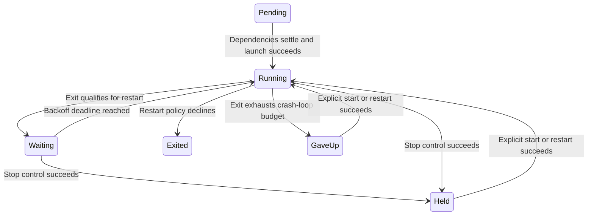

# Keep the command running when you want automatic restarts

`run` starts the selected services, polls them and stays alive until its stop condition. The CLI owns signal handling; library callers supply should_stop, a clock, event callback and optional controls. `up` does not leave this loop behind.

## Stop deliberately instead of fighting restart policy

A stop control asks the service owner to stop, then moves it to Held only when the stop result is accepted. Held services do not automatically restart. Explicit start/restart releases that hold and resets restart history. Unknown service names or invalid control lines emit a rejection; a declared service outside the initial selection can join through an explicit request.

The --control input protocol uses start/stop/restart plus service name. It acts through this loop, preserving child ownership and exit-status observation. In CLI control mode, stdin EOF requests global shutdown; merely closing the control pipe is not a way to detach supervision. Stopping the process independently through down can appear as a crash, causing restart:always to bring it back.

## Health and time are separate policy

Automatic restart requires an observed exit, eligible restart policy and remaining crash-loop budget. Backoff is bounded and deadline-based. Health changes are reported without killing/restarting a merely unhealthy process. A dependency with health checking delays its dependent only through a bounded health window; after timeout, or a settled failure/hold, the dependent can start anyway and fail on its own terms. It is not a guarantee every dependency is healthy before all launches.

Normal loop shutdown calls the finish path and stop owner. An early configuration, startup or control error can return after earlier effects, so inspect recorded services instead of assuming every error ran final cleanup. Process and container cleanup limits still apply. There is no guarantee this foreground supervisor survives its own process death.

## Model boundary

SupervisorHold starts with one restart pending at abstract tick 2, ticks 0..3 and an independent accepted hold. It checks automatic restart excludes Held and waits until deadline. Controls bypass hold and time guards. Hold represents successful stop-result acceptance, not a proof physical cleanup succeeded. Explicit start/reset, health, budget arithmetic, dependencies, process failures and multi-service shutdown are not modeled. Terminal deadlocks are disabled for finite completed states; these are safety properties with no liveness claim. [Evidence](verification.md) retains review and execution results.
